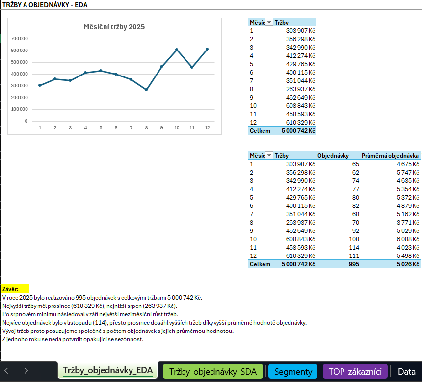
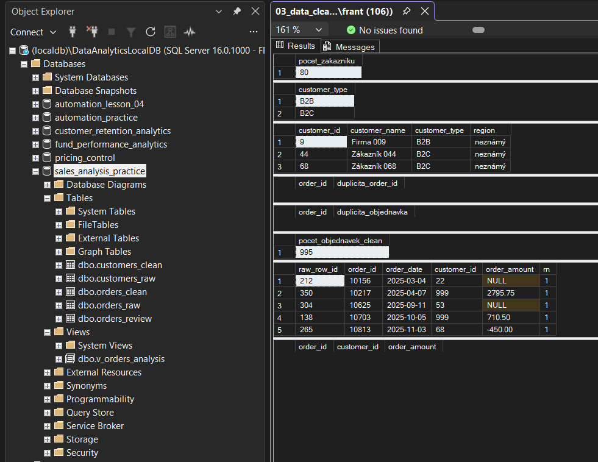
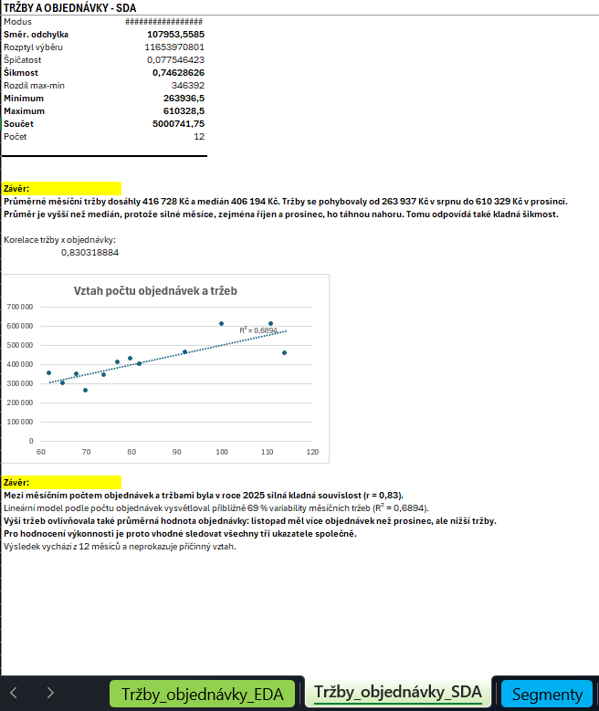

# Case Study 7 – 2025 Orders & Revenue Analysis

**SQL Server · SSMS · Excel · Power Query · Git**

## Přehled případové studie

Případová studie analyzuje objednávky a tržby syntetické obchodní společnosti se zákazníky v segmentech B2B a B2C. Cílem je popsat měsíční vývoj prodeje, porovnat segmenty a určit zákazníky s nejvyššími tržbami.

Zpracování začíná v SQL Serveru kontrolou a čištěním dat. Analytická vrstva je následně načtena přes Power Query do Excelu, kde jsou výsledky ověřeny a doplněny grafy a popisnou statistikou.

- **Období:** leden–prosinec 2025.
- **Rozsah:** 80 zákazníků a 1 005 zdrojových řádků objednávek.
- **Analytický soubor:** 995 objednávek od 76 zákazníků.
- **Granularita:** jeden řádek analytického pohledu představuje jednu objednávku.
- **Hlavní výstup:** Excelový sešit s analýzou a dokument se zjištěními a doporučeními.

[Excelový sešit](Excel/sales_analysis.xlsx) · [Detailní zjištění a doporučení](output/findings_recommendations.md)

## Obchodní zadání

Modelovým zadavatelem je obchodní manažer, který potřebuje posoudit vývoj prodeje a přínos zákaznických segmentů. Samotný počet objednávek mu nestačí: potřebuje sledovat také jejich hodnotu a podíl největších zákazníků na tržbách.

Analýza odpovídá na tři otázky:
1. **Jak se během roku vyvíjely objednávky a tržby?**
2. **Jak se liší segmenty B2B a B2C?**
3. **Kteří zákazníci přinesli nejvyšší tržby v každém segmentu?**

Výsledky slouží jako ukázka podkladů pro obchodní reporting a péči o zákazníky. Dataset je syntetický; případová studie nehodnotí skutečnou firmu.

## Zdroje dat

Zdrojová data jsou uložena ve dvou tabulkách databáze `sales_analysis_practice`.

| Tabulka               | Obsah                                     | Granularita |
| `dbo.customers_raw`   | ID a jméno zákazníka, segment a region    | Jeden řádek = jeden zákazník |
| `dbo.orders_raw`      | ID objednávky, datum, ID zákazníka a částka | Jeden zdrojový řádek objednávky; obsahuje také duplicitní kopie |

Zdrojová data obsahují záměrné nedostatky pro procvičení validace a čištění.

## Postup zpracování a role nástrojů

1. Vytvoření databáze a zdrojových tabulek v SQL Serveru.
2. Kontrola datových typů, duplicit, chybějících hodnot, kategorií, vazeb zákazníků, dat a částek.
3. Vytvoření čistých tabulek a oddělení problematických objednávek.
4. Propojení čistých dat do analytického pohledu `dbo.v_orders_analysis`.
5. Analýza v SQL pomocí agregací, CTE a window funkcí.
6. Načtení pohledu přes Power Query do Excelu.
7. Kontingenční tabulky, grafy, popisná statistika a interpretace výsledků.

| Nástroj               | Role                                                                  |
| SQL Server LocalDB    | Uložení dat, validace, čištění, analytický pohled a SQL analýza       |
| SSMS                  | Psaní a spouštění SQL skriptů                                         |
| Power Query           | Načtení pohledu, kontrola datových typů a doplnění měsíce objednávky  |
| Excel                 | Kontingenční tabulky, grafy, statistika a doplňující výpočty          |
| Git / GitHub          | Verzování a publikace případové studie                                |

Excel pracuje s jednou analytickou tabulkou. Výpočty využívají běžné vzorce a kontingenční tabulky bez Power Pivotu a DAX, protože by to v tomto případě bylo nadbytečné.

## Kvalita dat a čištění

Původní tabulky `customers_raw` a `orders_raw` zůstaly zachovány. Čištění vytváří tabulky `customers_clean`, `orders_clean` a `orders_review`.

| Zjištěný problém                  | Způsob zpracování                                 |
| 5 duplicitních kopií objednávek   | Ponechání prvního záznamu podle `raw_row_id` pomocí `ROW_NUMBER()` |
| Krajní mezery v textech           | Odstranění pomocí `TRIM()`                        |
| 3 chybějící regiony               | Nahrazení hodnotou „neznámý“ pomocí `COALESCE()`  |
| 2 objednávky bez částky           | Přesun k prověření, vyřazení z analýzy            |
| 1 objednávka se zápornou částkou  | Přesun k prověření, vyřazení z analýzy            |
| 2 objednávky se zákazníkem 999    | Přesun k prověření, vyřazení z analýzy            |

Počet objednávek byl ověřen: **1 005 zdrojových řádků − 5 duplicitních kopií − 5 objednávek k prověření = 995 čistých objednávek**.

Po čištění nebyly nalezeny duplicitní objednávky, chybějící či nekladné částky ani objednávky bez existujícího zákazníka. Počet objednávek a celkové tržby byly následně ověřeny také v Excelu.

## Analytická vrstva a SQL

Pohled `dbo.v_orders_analysis` propojuje objednávky se zákazníky přes `customer_id`. Obsahuje datum a částku objednávky, identifikátory objednávky a zákazníka, jméno zákazníka, segment a region.

| SQL postup                        | Použití v případové studii                        |
| `JOIN` / `LEFT JOIN`              | Propojení dat a kontrola objednávek bez zákazníka |
| `GROUP BY`, `COUNT`, `SUM`, `AVG` | Počty objednávek, tržby a průměrné hodnoty        |
| CTE                               | Rozdělení dotazů do čitelných mezivýpočtů         |
| `ROW_NUMBER()`                    | Odstranění duplicitních kopií objednávek          |
| `LAG()`                           | Porovnání tržeb s předchozím měsícem              |
| `RANK()`                          | Pořadí zákazníků podle tržeb v každém segmentu    |
| `NULLIF()`                        | Ošetření případného dělení nulou při výpočtu změny|

Zákazníci jsou agregováni podle ID, segmentu a jména. `RANK()` zachovává shodné pořadí při stejných tržbách; u výsledných TOP zákazníků remízy nenastaly.

Kompletní dotazy jsou v [analytickém SQL skriptu](SQL/04_analytical_layer_EDA.sql).

## Analýza v Excelu

Pohled byl načten přes Power Query a doplněn o měsíc objednávky. Sešit obsahuje následující listy:

| List                      | Obsah                                                         |
| `Data`                    | Analytická tabulka načtená ze SQL Serveru                     |
| `Tržby_objednávky_EDA`    | Měsíční tržby, počty objednávek, průměrná objednávka a graf   |
| `Tržby_objednávky_SDA`    | Popisná statistika měsíčních tržeb, korelace a bodový graf    |
| `Segmenty`                | B2B/B2C: počty, tržby, průměry, mediány a podíly              |
| `TOP_zákazníci`           | TOP 3 zákazníci každého segmentu a podíl jejich tržeb         |

Popisná statistika a korelace vycházejí z **12 měsíčních pozorování**. Mediány segmentů jsou vypočteny z jednotlivých objednávek pomocí `MEDIAN` a `FILTER`. Podíl TOP 3 používá celkové tržby příslušného segmentu jako jmenovatel.

## Hlavní zjištění

- **Celkové tržby dosáhly 5 000 741,75 Kč při 995 objednávkách.** Průměrná hodnota objednávky činila 5 025,87 Kč.
- **Prosinec měl nejvyšší tržby: 610 328,50 Kč.** Srpen nejnižší: 263 936,50 Kč. Největší meziměsíční procentní růst nastal v září (+75,29 %).
- **Listopad měl nejvíce objednávek (114), ale prosinec vyšší tržby.** Prosincové objednávky měly vyšší průměrnou hodnotu.
- **Měsíční počet objednávek a tržby vykázaly silnou kladnou souvislost (r = 0,83).** Lineární model zachytil přibližně 69 % variability měsíčních tržeb v analyzovaných datech (R² = 0,6894).
- **B2B vytvořil 82,72 % tržeb při 425 objednávkách.** B2C vytvořil 17,28 % tržeb při 570 objednávkách. Průměrná objednávka B2B byla přibližně 6,42krát vyšší.
- **Vyšší hodnotu objednávek B2B potvrzuje také medián:** 9 463,75 Kč oproti 1 510,88 Kč u B2C.
- **Nejvyšší tržby přinesla Firma 004 v B2B a Zákazník 074 v B2C.** TOP 3 zákazníci vytvořili 16,16 % tržeb B2B a 10,15 % tržeb B2C.

## Doporučení

| Oblast                | Doporučení pro modelového zadavatele |
| Měsíční reporting     | Sledovat společně tržby, počet objednávek a průměrnou hodnotu objednávky |
| Výkyvy tržeb          | Prověřit srpnový pokles a zářijový růst podle segmentů a konkrétních objednávek |
| Segmenty              | B2B a B2C vyhodnocovat samostatně; u B2B sledovat udržení zákazníků, u B2C možnosti zvýšení hodnoty objednávky |
| Největší zákazníci    | Sledovat jejich další nákupy                                         |
| Kvalita dat           | Prověřit pět vyřazených objednávek a opravit je až po ověření zdroje |

Doporučení jsou návrhy k dalšímu ověření.

Podrobnosti: [Zjištění a doporučení](output/findings_recommendations.md).

## Aktualizace a omezení

Zpracování je opakovatelné pomocí SQL skriptů; Excel načítá analytický pohled přes Power Query. Aktualizace se spouští ručně. Po změně dat je potřeba obnovit také kontingenční tabulky a přepočítat statistické výstupy. Výstup nástroje Popisná statistika je statický a po změně zdrojových hodnot se musí vytvořit znovu.

Hlavní omezení:
- Data jsou syntetická a pokrývají pouze rok 2025.
- Z jednoho roku nelze potvrdit opakující se sezónnost.
- Korelace popisuje souvislost, nikoli příčinu. Počet objednávek navíc přímo vstupuje do výpočtu tržeb.
- Analýza nezahrnuje náklady, a proto nehodnotí ziskovost.
- Pět objednávek zůstává mimo analýzu do jejich prověření.

## Struktura případové studie

| Cesta | Obsah |
| [`SQL/01_create_database_raw_tables.sql`](SQL/01_create_database_raw_tables.sql) | Vytvoření databáze a zdrojových tabulek |
| [`SQL/02_data_validation.sql`](SQL/02_data_validation.sql) | Kontrola kvality zdrojových dat |
| [`SQL/03_data_clean.sql`](SQL/03_data_clean.sql) | Čištění, objednávky k prověření a následná validace |
| [`SQL/04_analytical_layer_EDA.sql`](SQL/04_analytical_layer_EDA.sql) | Analytický pohled a SQL analýza |
| [`Excel/sales_analysis.xlsx`](Excel/sales_analysis.xlsx) | Excelový sešit |
| [`output/findings_recommendations.md`](output/findings_recommendations.md) | Detailní zjištění a doporučení |
| `screenshots/` | Pět snímků SQL validace a výsledků Excelu |
| `README.md` | Přehled případové studie |